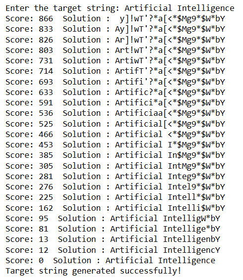

<h1>ExpNo 5 : Implement Simple Hill Climbing Algorithm</h1> 
<h3>Name: GOMATHI G </h3>
<h3>Register Number:  212225230079 </h3>
<H3>Aim:</H3>
<p>Implement Simple Hill Climbing Algorithm and Generate a String by Mutating a Single Character at each iteration </p>
<h2> Theory: </h2>
<p>Hill climbing is a variant of Generate and test in which feedback from test procedure is used to help the generator decide which direction to move in search space.
Feedback is provided in terms of heuristic function
</p>


<h2>Algorithm:</h2>
<p>
<ol>
 <li> Evaluate the initial state.If it is a goal state then return it and quit. Otherwise, continue with initial state as current state.</li> 
<li>Loop until a solution is found or there are no new operators left to be applied in current state:
<ul><li>Select an operator that has not yet been applied to the current state and apply it to produce a new state</li>
<li>Evaluate the new state:
  <ul>
<li>if it is a goal state, then return it and quit</li>
<li>if it is not a goal state but better than current state then make new state as current state</li>
<li>if it is not better than current state then continue in the loop</li>
    </ul>
</li>
</ul>
</li>
</ol>

</p>
<hr>
<h3> Steps Applied:</h3>
<h3>Step-1</h3>
<p> Generate Random String of the length equal to the given String</p>
<h3>Step-2</h3>
<p>Mutate the randomized string each character at a time</p>
<h3>Step-3</h3>
<p> Evaluate the fitness function or Heuristic Function</p>
<h3>Step-4:</h3>
<p> Lopp Step -2 and Step-3  until we achieve the score to be Zero to achieve Global Minima.</p>

<hr>
<h2>Sample Input and Output</h2>
<h2>Sample String:</h2> Artificial Intelligence
<h2>Output:</h2>
Score: 643  Solution :  8RzF:oG ]%;CPORRMe!zGvk<br>
Score: 609  Solution :  8RzF:oG ]%;CPqRRMe!zGvk<br>
Score: 604  Solution :  8RzF:oG ]%;CPqRRMe!zGqk<br>
Score: 594  Solution :  8RzF:oG ]%;CPqRRWe!zGqk<br>
Score: 551  Solution :  8RzF:oGK]%;CPqRRWe!zGqk<br>
Score: 551  Solution :  8RzF:oGK]%;CPqRRWe!zGqk<br>
Score: 551  Solution :  8RzF:oGK]%;CPqRRWe!zGqk<br>
Score: 551  Solution :  8RzF:oGK]%;CPqRRWe!zGqk<br>
Score: 551  Solution :  8RzF:oGK]%;CPqRRWe!zGqk<br>
....................................................<br>
..................................................<br>
................................................<br>
Score: 1  Solution :  Artificial Intelligencf<br>
Score: 1  Solution :  Artificial Intelligencf<br>
Score: 1  Solution :  Artificial Intelligencf<br>
Score: 1  Solution :  Artificial Intelligencf<br>
Score: 0  Solution :  Artificial Intelligence<br>

# PROGRAM:
```
import random
import string

def fitness(current, target):
    score = 0
    for a, b in zip(current, target):
        score += abs(ord(a) - ord(b))
    return score

def hill_climbing(target):
    characters = string.ascii_letters + string.digits + string.punctuation + " "
    current = ''.join(
        random.choice(characters) for _ in range(len(target))
    )

    score = fitness(current, target)
    print("Score:", score, " Solution :", current)

    while score > 0:
        improved = False

        for i in range(len(target)):
            if current[i] == target[i]:
                continue

            candidate_char = target[i]
            candidate = current[:i] + candidate_char + current[i + 1:]
            candidate_score = fitness(candidate, target)

            if candidate_score < score:
                current = candidate
                score = candidate_score
                improved = True
                print("Score:", score, " Solution :", current)

                if score == 0:
                    break

        if not improved:
            break

    if score == 0:
        print("Target string generated successfully!")
    else:
        print("Local optimum reached.")

target = input("Enter the target string: ")
hill_climbing(target)

```
# Output:



# Result:
Thus the Simple Hill Climb Algorithm Implemented successfully.